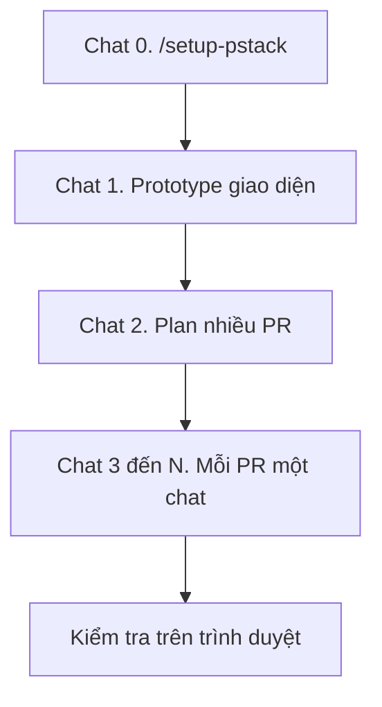

# Xây clone Tiki bằng pstack

Cuối hướng dẫn này bạn có một cửa hàng học tập trong repo `ecomerce-clone`. Người mua mở trang chủ, tìm sản phẩm, xem chi tiết, thêm vào giỏ, đăng nhập, và đặt hàng thanh toán khi nhận hàng. Repo gồm frontend, backend, và Postgres.

Mỗi mục dưới đây là một chat mới trong Cursor. Bạn dán đúng một prompt. pstack tự chọn các bước. Bạn chỉ nói mục tiêu và cách biết là xong.

Nguồn của các lệnh nằm trong plugin pstack: [Set up pstack](https://github.com/cursor/plugins/blob/main/pstack/docs/guide/01-setup.md), [Start a task with /poteto-mode](https://github.com/cursor/plugins/blob/main/pstack/docs/guide/02-poteto-mode.md), [Design before you write code](https://github.com/cursor/plugins/blob/main/pstack/docs/guide/04-design.md), và [Word the prompt](https://github.com/cursor/plugins/blob/main/pstack/skills/poteto-help/references/prompting.md).

## Chuẩn bị pstack

Máy này chưa có `~/.cursor/rules/pstack-models.mdc`. Mọi role của pstack đang dùng model mặc định.

1. Mở một chat và gõ `/setup-pstack`.
2. Chọn ngân sách suy luận. `medium` tốn ít token hơn. `large` là mức mặc định của plugin.
3. Trả lời các câu hỏi về model cho từng role. Rule chỉ có hiệu lực ở chat mới.
4. Khi setup hỏi skill kiểm tra ứng dụng, chọn có. Agent sẽ có cách tự bấm được cửa hàng sau này.

Bật `/poteto-mode` thành Custom Mode trước khi làm việc dài. Trên Mac, gõ skill rồi nhấn Option+Enter, hoặc chọn Use as Mode. Custom Mode giữ skill ở mọi lượt cho đến khi bạn thoát. Nhấn Enter thường chỉ gắn skill vào một tin nhắn.

## Giữ bản đầu trong phạm vi người mua

Bản đầu có ba biên.

- Web là trang người mua thấy.
- API là nơi đơn, giỏ, và tài khoản được ghi.
- Postgres là nơi dữ liệu nằm. Chạy Postgres bằng Docker.

Luồng người mua gồm các màn này.

1. Trang chủ có ô tìm kiếm, danh mục, và lưới sản phẩm. Mỗi thẻ có giá, phần trăm giảm, và số đã bán.
2. Trang danh mục và trang kết quả tìm kiếm.
3. Trang sản phẩm với nút thêm vào giỏ.
4. Giỏ hàng, đổi số lượng, xóa dòng.
5. Đăng ký và đăng nhập.
6. Thanh toán với địa chỉ giao và thanh toán khi nhận hàng.
7. Danh sách đơn của tài khoản vừa đăng nhập.

Để seller, flash sale đếm giờ, cổng thanh toán, vận chuyển, chat, và gợi ý sản phẩm cho một đợt sau. Thêm chúng khi luồng mua ở trên chạy trên trình duyệt.

Stack mặc định khi bạn không chọn khác: Next.js cho web, một API Node riêng, Prisma cho schema, Postgres trong Docker Compose. Agent được đổi chi tiết bên trong ba biên đó khi một bản chạy chứng minh cách khác gọn hơn. Bạn giữ ba biên.



## Chat 1. Chốt giao diện bằng prototype

Mở chat mới, bật Custom Mode `/poteto-mode`, rồi dán:

```text
/poteto-mode prototype a few options for a Tiki-like buyer storefront in this empty repo.

Scope is the buyer path only. Home with search, categories, and a product grid. Product page. Cart. Login. Checkout with cash on delivery.

Show me screenshots of at least two layouts. Stop before any API, database, or durable app code. I will pick a layout.
```

Bạn xem ảnh và nói layout nào giữ. Câu đó là cả prompt của lượt sau. Ví dụ: `keep layout B. continue.`

## Chat 2. Viết plan, chưa code

Mở chat mới trong cùng repo.

```text
/poteto-mode turn the chosen storefront into a plan. small verifiable PRs, each with its own verification steps.

Constraints. Separate web, API, and Postgres. Buyer path only: catalog, search, product, cart, auth, cash-on-delivery checkout, order list. Seed products so the home page is not empty.

Done means a plan file I can run box by box. Do not implement.
```

Đọc plan. Mỗi PR phải kết thúc bằng một việc bạn nhìn thấy trên trình duyệt hoặc một lệnh test có pass hoặc fail. Sửa plan bằng một câu nếu một PR ôm hai việc. Ví dụ: `split checkout and order history into two PRs.`

## Chat 3 trở đi. Làm một PR mỗi chat

Lấy đúng một PR từ plan. Mở chat mới. Dán mẫu này và thay phần trong ngoặc nhọn.

```text
/poteto-mode implement only <PR id and its one-line goal> from the plan.

Leave every other PR untouched. The web, API, and database from earlier PRs keep working.

Done when:
- the new behavior is visible in the browser, or the API returns the new payload
- you paste the command output that proves it
- you name the URL or request I can repeat

Stop after this PR. Show me the screen or the response body.
```

Thứ tự an toàn cho plan nếu agent để bạn chọn:

1. Khung repo, Docker Postgres, schema, và dữ liệu mẫu. Xong khi `docker compose up` chạy và một lệnh liệt kê được sản phẩm mẫu.
2. API danh mục cộng trang chủ, trang danh mục, trang tìm kiếm, trang sản phẩm. Xong khi bạn mở trang chủ và thấy sản phẩm mẫu.
3. Giỏ hàng. Xong khi thêm một sản phẩm, đổi số lượng, và số lượng còn sau khi tải lại trang.
4. Đăng ký và đăng nhập. Xong khi một tài khoản mới đăng nhập lại được sau khi tải lại trang.
5. Thanh toán khi nhận hàng. Xong khi một đơn mới nằm trong Postgres và giỏ của tài khoản đó trống.
6. Danh sách đơn. Xong khi tài khoản vừa mua thấy đúng đơn đó, và một tài khoản khác không thấy đơn ấy.

## Biết một lượt đã xong

Một lượt xong khi bạn lặp lại được việc agent khoe.

- Với UI, bạn tự mở URL, bấm cùng đường đi, và thấy cùng trạng thái.
- Với API, bạn gửi lại request và thấy cùng thân response.
- Với database, bạn query và thấy dòng mới.

Log build xanh chưa đủ. Nhờ agent chỉ ra output thật nếu reply chỉ nói test đã pass.

```text
apply prove it works. show me the real output, not the build log.
```

## Khi chat đi lệch

Gõ một câu. Giữ nguyên mục tiêu.

| Bạn thấy | Bạn gõ |
| --- | --- |
| Agent bắt đầu sửa code trong chat prototype | `i said prototype. i did not ask for app code yet.` |
| Agent làm hai PR trong một chat | `stop. this chat is only <PR id>.` |
| Agent hỏi bạn chọn cách code | `pick the smallest one that passes the done check. show me the result.` |
| Chủ đề đổi sang việc khác | `new task` rồi prompt mới |

## Đợt sau bản người mua

Khi sáu PR trên chạy trên máy bạn, mở chat mới cho từng việc. Mỗi việc một prompt, một điều kiện xong, một bằng chứng trên trình duyệt.

- Đánh giá sao trên trang sản phẩm.
- Một hàng flash sale với giờ kết thúc cố định trong dữ liệu mẫu.
- Trang quản trị thêm và sửa sản phẩm.

Giữ seller nhiều shop, cổng thanh toán, và gợi ý cho đến khi ba việc trên xong.
